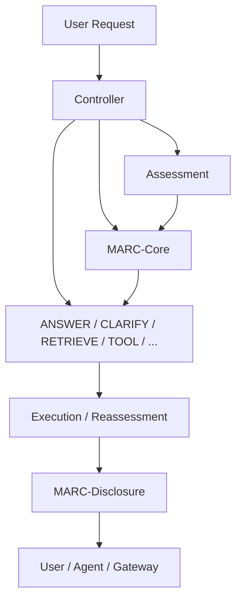

# MARC Reference Implementation

Reference implementation and interoperability test suite for MARC: A Control and Uncertainty Disclosure Profile for Generative Models and Agents.

MARC is currently specified by the individual Internet-Draft
`draft-c4tz-marc` and has Intended Status: Informational.

This repository does not define a separate version of MARC.
The Internet-Draft remains the specification source.

This revision implements the semantics of [`draft-c4tz-marc-02`](https://datatracker.ietf.org/doc/draft-c4tz-marc/02/), including the MARC 1.0 JSON encoding, cross-field constraints, disclosure projection, and validation vectors. An Internet-Draft is a work in progress and may be updated, replaced, or expire.

## What MARC solves

Generative systems often make answering, clarification, retrieval, tool-use, deliberation, abstention, and escalation decisions with incompatible metadata. MARC supplies a small vendor-neutral representation for the control state at each decision point. It distinguishes pre-decision capability from post-answer confidence, identifies the source and remediability of uncertainty, and makes the target of a confidence band explicit.

MARC does not standardize model internals, transport, authentication, authorization, tool schemas, provenance, calibration methods, or task execution. This repository implements validation and projection; it does not redefine those boundaries.

The `safety` class is included in the uncertainty attribution object for operational convenience, but represents a control constraint rather than purely epistemic uncertainty.

## Architecture



See [Architecture](docs/architecture.md) for component boundaries and processing stages.

## Five-minute quick start

From the repository root:

```bash
python3 -m venv .venv
source .venv/bin/activate
python -m pip install -e ".[dev]"
npm ci
npm run build

marc validate examples/valid/answer.json
marc validate examples/invalid/score-out-of-range.json
python -m pytest
npm test
```

The two CLI commands exit with status `0` and `1`, respectively. A valid record with a SHOULD-level deviation remains valid and displays a separate `WARNINGS` section. Use `--json` for the structured result:

```bash
marc validate examples/valid/answer.json --json
```

## MARC-Core example

```json
{
  "marc_version": "1.0",
  "decision_id": "answer-001",
  "pre_capability": 0.86,
  "uncertainty": {
    "ambiguity": 0.05,
    "missing_evidence": 0.12,
    "capability_limit": 0.08,
    "evidence_conflict": 0.02,
    "safety": 0.0
  },
  "primary_source": "missing_evidence",
  "remediability": "none",
  "selected_action": "ANSWER",
  "post_answer_confidence": 0.88,
  "confidence_band": "high",
  "confidence_target": "answer",
  "recommended_next_step": "review the cited sources"
}
```

Uncertainty scores are salience or severity estimates, not mutually exclusive probabilities. They are not required to sum to `1.0`.

## MARC-Disclosure example

```json
{
  "answer": "The documented behavior is supported.",
  "confidence_band": "high",
  "confidence_target": "answer",
  "uncertainty_source": "missing_evidence",
  "recommended_next_step": "review the cited sources",
  "selected_action": "ANSWER"
}
```

The deterministic projection copies the coarse disclosure fields and user-visible content. It does not expose numeric capability, uncertainty, or answer-confidence values by default.

Python:

```python
from marc import project_disclosure, validate_core, validate_disclosure

core_result = validate_core(core_record)
disclosure = project_disclosure(core_record, "The documented behavior is supported.")
disclosure_result = validate_disclosure(disclosure)
```

TypeScript:

```typescript
import { projectDisclosure, validateCore, validateDisclosure } from "./typescript/dist/index.js";

const coreResult = validateCore(coreRecord);
const disclosure = projectDisclosure(coreRecord, "The documented behavior is supported.");
const disclosureResult = validateDisclosure(disclosure);
```

## Validation behavior

Both implementations return the same shape:

```json
{
  "valid": true,
  "errors": [],
  "warnings": []
}
```

MUST violations are errors. The action/remediability SHOULD relationships are warnings and do not make a record invalid. JSON Schemas provide structural validation aids; the language validators add structured warning behavior and stable messages.

## Interoperability tests

The common vectors live in [`interoperability/vectors.json`](interoperability/vectors.json). They cover every MARC action, all requested negative cases, and a SHOULD-level warning case. Python and TypeScript consume the same file, compare against [`expected-results.json`](interoperability/expected-results.json), and compare directly with one another.

```bash
python -m pytest tests/test_interoperability.py
npm run test:interop
```

See the [interoperability guide](docs/interoperability.md) to test an independent implementation.

## Repository map

- [`schemas/`](schemas/) — non-normative JSON Schema validation aids;
- [`python/marc/`](python/marc/) — typed Python models, validators, projection, and CLI;
- [`typescript/src/`](typescript/src/) — equivalent TypeScript types, validators, and projection;
- [`examples/`](examples/) — seven valid action records and five targeted invalid records;
- [`interoperability/`](interoperability/) — language-neutral vectors and canonical results;
- [`integrations/`](integrations/) — small vendor-neutral controller, RAG, and gateway examples;
- [`docs/`](docs/) — architecture, implementation, mapping, trust, and interop guidance.

## Trust and security

A MARC record is an assertion about a decision point, not proof that a selected action, score, band, source, target, or answer is correct. Treat it as security-relevant metadata when it influences routing or automation. See the [trust model](docs/trust-model.md) and [security policy](SECURITY.md).

## Contributing

Independent validators and compatibility results are first-class contributions. Read [CONTRIBUTING.md](CONTRIBUTING.md), run both test suites, and use the implementation-report issue template to publish evidence from another implementation.

## License

This reference implementation is available under the [MIT License](LICENSE). The Internet-Draft has its own copyright and legal notices.
